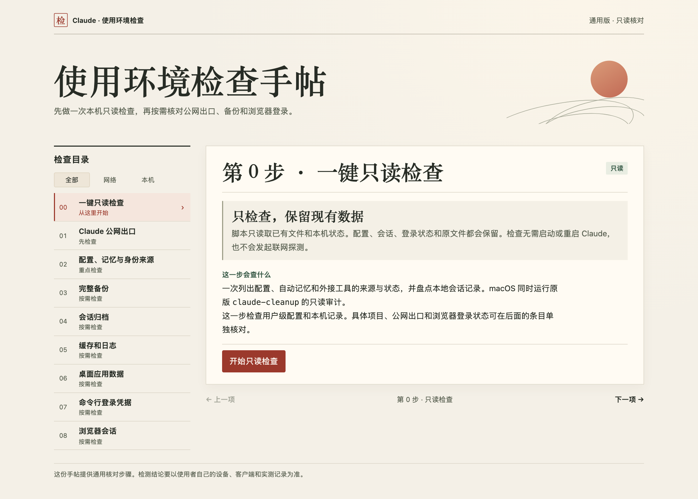

# Claude 使用环境检查手帖

这套 Codex 技能和网页手帖帮助你逐项核对 Claude 的公网出口、配置、记忆、外接工具以及会话备份。

## 下载项目，打开手帖

**下载完整项目，双击启动文件，点「开始只读检查」。** 结果直接显示在手帖里。电脑需要 Python 3.9 或更新版本。

1. **下载项目。** 在终端运行下面这条克隆命令。已经克隆的用户可以先拉取最新版本。

   ```bash
   git clone https://github.com/huangserva/claude-environment-checklist.git
   ```

2. **启动本地手帖。** macOS 双击 `Start-Checklist.command`，Windows 双击 `Start-Checklist.cmd`。Linux 在项目文件夹运行 `python3 -B launch_checklist.py`，其中 `-B` 禁止写入 Python 字节码缓存。启动器会用浏览器打开手帖。
3. **点「开始只读检查」。** 第 0 步会盘点用户级配置、记忆、外接工具和本机会话记录，结果直接显示在本地页面。关闭启动器的终端窗口即可退出手帖。

如果你现在只在聊天里贴了 GitHub 链接，可以先发这一句。

> 我想用这个项目。请先告诉我怎么下载完整仓库，再用 Codex 技能 `$claude-environment-checklist` 打开下载里的网页手帖，等我选定要执行的检查项。

[预览网页手帖](https://huangserva.github.io/claude-environment-checklist/)

[](https://huangserva.github.io/claude-environment-checklist/)

## 遇到什么问题，从哪一项查

| 遇到的问题 | 建议先看 |
| --- | --- |
| 想先了解本机现状，保留所有文件和设置 | [第 0 步 · 一键只读检查](https://huangserva.github.io/claude-environment-checklist/#quick-audit)。一次盘点配置、记忆、外接工具和本机会话记录。 |
| Claude 连不上，或者浏览器和终端的公网出口不同 | [公网出口](https://huangserva.github.io/claude-environment-checklist/#network-egress)。对照 Claude 的已有连接与出口检测请求，确认它们实际走的线路。 |
| Claude 知道你没在当前对话里提过的姓名、偏好或旧项目 | [配置、记忆与身份来源](https://huangserva.github.io/claude-environment-checklist/#identity-context)。从指令文件、自动记忆、项目记录、插件和外接工具找来源。 |
| 同一台电脑上的浏览器登录状态不同 | [浏览器会话](https://huangserva.github.io/claude-environment-checklist/#browser-data)。逐个浏览器配置查 Claude 和 Anthropic 的网站数据，另行核验当前登录状态。 |
| 换机、重装，或准备清理本机数据 | [完整备份](https://huangserva.github.io/claude-environment-checklist/#old-backup)和[会话归档](https://huangserva.github.io/claude-environment-checklist/#sessions)。先核对要保留的会话和可恢复的副本。 |

手帖也提供缓存与日志、桌面应用数据和命令行凭据的核对步骤。

## 怎么用

### 打开网页逐项核对

从手帖左侧选择你遇到的问题，再按该项的步骤操作。公网出口、浏览器网站数据和具体项目配置可在对应条目单独检查。只想浏览时，可以直接打开 `index.html`。

### 用 Codex 或终端检查具体项目

可以在 Codex 中打开下载的项目，调用 `$claude-environment-checklist`。手帖各条目也提供「交给 Codex」的指令。[查看技能文件](.agents/skills/claude-environment-checklist/SKILL.md)

从终端执行时，在下载的 `claude-environment-checklist` 文件夹运行下面的命令。把示例路径换成 Claude 实际工作的项目目录。

**macOS 或 Linux**

```bash
python3 -B audit_context.py --project "/Claude实际工作的项目目录"
```

**Windows PowerShell**

```powershell
py -3 -B audit_context.py --project "C:\Claude实际工作的项目目录"
```

`-B` 禁止 Python 写入字节码缓存，`--project` 指定要检查的项目。Windows 的 `-3` 指定 Python 3。

在 macOS 上，脚本会同时输出原版 `claude-cleanup` 的本机审计和本项目的配置检查。前者盘点默认目录、缓存、日志、桌面数据和相关进程，后者查配置、记忆和外接工具。Windows 和 Linux 会运行配置检查，原版专用于 macOS 的审计标为「不适用」。

### 怎么判断结果

例如，报告出现下面两行时，说明在全局配置中找到了一个外接记忆工具的声明。是否有连接或调用记录，应回到实际使用的 Claude 会话核对。

```text
【已配置】外接工具 · ~/.claude.json
  用户级 · example-memory · 连接与调用情况未核验
```

脚本只读本机状态，结果只输出到终端。它列出来源、状态和线索类型，凭据原值与文件正文保留在本机。云端账号记忆在账号设置里核对。[Claude Code 指令与记忆说明](https://code.claude.com/docs/en/memory)

<details>
<summary>自定义工作目录、配置路径和输出格式</summary>

| 选项 | 用途 |
| --- | --- |
| `--project 路径` | 指定 Claude 实际工作的目录。 |
| `--config-dir 路径` | 指定配置检查使用的 Claude 目录。原版审计仍盘点 macOS 默认目录。 |
| `--settings 文件`、`--mcp-config 文件` | 补查自定义启动设置和外接工具配置。可以重复指定。 |
| `--backup-dir 目录` | 补查历史配置备份。可以重复指定。 |
| `--json` | 将两部分结果以便于程序读取的结构化格式输出到终端。 |

</details>

## 原版来源

脚本内置 Suyuan 的 `claude-cleanup` 只读审计逻辑，并保留上游版权和许可。[原版源码](https://github.com/suyuan2022/suyuan-skill/blob/8babd4557a4774ca8e3d5b784d82f0ee5a4565e5/claude-cleanup/scripts/claude_cleanup.py) · [原版开源许可](https://github.com/suyuan2022/suyuan-skill/blob/8babd4557a4774ca8e3d5b784d82f0ee5a4565e5/LICENSE)
